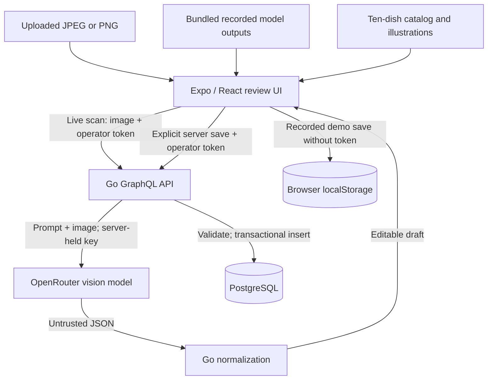

# Menu Import: architecture and engineering tradeoffs

This document explains the implemented photo-to-menu workflow, its trust boundaries, and where another developer should make changes. It accompanies the [setup instructions](README.md#run-the-complete-application) and [hosted demo](https://menu-review.smartmade.site/).

## Purpose and scope

A restaurant owner uploads a menu photo, reviews an extracted draft against the original, corrects mistakes, and saves the dishes together. AI handles visual transcription; ordinary code validates structure, handles money, suggests catalog matches, and persists the reviewed data.

This is a focused reimplementation of a workflow from a Laravel Billing project, using Go, GraphQL, PostgreSQL, TypeScript, React and Expo. It does not connect to Billing. The original workflow includes multi-photo import and provider fallback; this sample accepts one photo and configures OpenRouter only.

The broader product idea is voice-assisted restaurant operations, including inventory and routing table orders to the kitchen and cashier. Those capabilities are not implemented here. This repository demonstrates one import workflow, not a complete restaurant platform.

## Runtime boundaries

The Docker image contains the Go service and the Expo web export. Go serves static files, `/graphql`, and `/healthz`; PostgreSQL runs separately. Local and hosted installations use the same application with different runtime configuration. An API key enables the server's live provider; it does not replace the frontend or create a second implementation.

The browser does not receive the provider key. The operator token authorizes use of the backend and is a separate credential. It is held in React state and sent in `X-Review-Token`. All GraphQL operations, including `demoDraft`, require it. Public recorded demos load bundled JSON directly, so they do not call that endpoint.

## End-to-end flow

### 1. Obtain a draft

**Live scan:** `App.tsx` uses Expo ImagePicker and sends a base64 image data URI through `scanMenu`. The backend checks image format, decoded size and dimensions before making a provider request. The request contains the image and the prompt in `scanner.go`: extract categories, names, decimal prices, portions, printed dietary labels, currency and an optional confidence estimate. It does not send the catalog or existing saved menus.

The provider response must contain one completed choice with `finish_reason: stop`. Go parses its content into the expected schema, rejects unknown fields and malformed structure, and limits the draft to 100 dishes. Invalid or missing prices become `null`; unsupported currency becomes `UNKNOWN`. A single JSON Markdown fence is tolerated, but arbitrary surrounding prose is not.

**Recorded demo:** the selected image/model pair loads its saved draft from `demo-runs.json`. No model runs and no API cost is incurred. In-progress edits are retained in memory for each pair while switching examples. They are not durable until saved. The separately selectable reference data must not be confused with a model response.

Both paths enter the same editor. Neither extraction path writes restaurant data automatically.

### 2. Review and enrich

The editor supports changing dish names, categories, prices, dietary labels and existing portions, removing dishes, adding missing dishes, and attaching dish photos. The source menu remains available for comparison. Invalid fields and model confidence affect review colors; they do not prove correctness or locate every missed item.

The ten-dish catalog is a bundled presentation aid, not a restaurant database or a recognition engine:

- An exact normalized name match supplies an illustration when no uploaded photo exists.
- A close name match offers an explicit action to replace the name and category. It never changes the price or dietary label.
- Matching uses normalized text and edit distance, with a maximum distance of two, reduced for short names. Ties and unrelated names produce no suggestion.
- Dishes outside the catalog remain editable and can receive a manually uploaded photo. Catalog membership is not required for saving.

“Mark as verified” is an editor indicator. Changes reset it, but saving does not require every dish to carry that flag. Neither this flag nor model confidence is included in the save input or retained as a database audit record. Dietary classification may remain unspecified.

### 3. Save to the appropriate destination

| Situation | Destination | Consequence |
|---|---|---|
| Recorded demo, no token, web browser | `localStorage` | Persists on that browser/device only; no restaurant database write |
| Recorded demo with token, or live extraction | Go `saveMenu` → PostgreSQL | Server validates input and inserts a new menu and all dishes together |
| Recorded demo without token on native | No save | UI asks for server configuration; browser storage is web-only |

The browser checks required fields and currency before either save. Server saves additionally pass domain validation in the resolver and store. Browser-local storage is a demo convenience, not equivalent to server validation or durable account storage. Its reader checks that stored data is an array, not every nested field.

PostgreSQL inserts the parent menu and ordered child dishes in one transaction using parameterized SQL. A failed insert rolls back the transaction. On a successful response the client clears the draft and displays the saved menu. A failed save keeps the draft available.

## Data model and invariants

| Data | Representation and rule |
|---|---|
| Menu | ID, name, currency; server also records creation time |
| Dish | Category, name, integer `priceMinor`, nullable vegetarian flag, optional photo, ordered position and portions |
| Portions | Named prices stored as JSONB inside each dish; at most 20 per dish |
| Currency | INR or USD for saved menus; `UNKNOWN` is allowed during review |
| Price | Positive integer minor units on save, at most 9,999,999; zero-price dishes are not supported |
| Dietary label | `true`, `false`, or `null`; unknown must not silently mean non-vegetarian |

For example, a printed `10.10` becomes `1010`, is displayed as `10.10`, and is saved as integer `1010`. Both parsers use decimal text rather than floating-point multiplication. Negative values, currency-prefixed strings and more than two decimal places are not silently repaired. A missing price must be corrected before save. Changing currency changes its label; it does not convert amounts.

Variants are JSONB because this sample reads and saves them with the dish. Independently querying or editing portions would justify relational rows. Uploaded dish photos are data URIs stored with the dish; catalog illustrations remain bundled assets resolved from names. The original uploaded menu photo and live provider response are not persisted in the menu tables.

The database enforces uniqueness of `(menu_id, category, name)`, using case-sensitive text comparison. It does not prevent saving the same complete menu twice.

## Reliability and security decisions

| Decision | Benefit | Tradeoff or remaining gap |
|---|---|---|
| Treat model output as untrusted | Invalid structure cannot flow directly into persistence | A plausible but incorrect name, price or dietary flag can still pass |
| Separate scan and save mutations | Owner can inspect and change output before writing | Human review is encouraged, not a recorded approval workflow |
| Bounded provider retry | A transient transport error, 429 or 5xx can recover | A retry can incur another provider charge; invalid model JSON is not repaired automatically |
| Transactional save | Avoids partially inserted menus | Does not provide exactly-once saving after a lost response |
| Small catalog suggestions | Helps repair close spelling mistakes and provides illustrations | Does not identify arbitrary dishes, ingredients or allergens |
| Single operator credential | Keeps the sample's paid scans and server data behind authentication | No user accounts, tenant isolation, roles, token expiry or rate limiting |

Production configuration makes at most two attempts against its one provider, with a 300 ms delay before retry. HTTP calls have a 12-second timeout within a 45-second GraphQL context. The client aborts after 50 seconds. These are time bounds, not an availability guarantee. Provider failures are reported generically; detailed operational diagnosis is limited.

Bounds include a 4 MiB decoded scan image, 25 megapixels, a 1 MiB provider response, a 6 MiB GraphQL body, a 12,000-byte query, query depth eight, 100 dishes, and 350,000 characters per attached dish photo. Many individually valid photos can exceed the combined request limit. These limits do not replace request rate limiting or GraphQL cost analysis.

Provider credentials belong in ignored local `.env` files or injected runtime secrets, never frontend environment variables. The default Compose token and database credentials are for its loopback-only local setup. Shared deployments need private credentials and TLS. Images submitted for live scanning leave the application for OpenRouter and its selected provider; recorded playback makes no such request.

## Failure behavior and known limits

- **Unavailable live provider:** without a configured key, scanning returns an error; recorded playback still works. Entering an operator token alone does not establish provider readiness.
- **Missing or wrong AI content:** the owner compares the source and adds or corrects dishes. There is no independent OCR cross-check, automatic missing-region detection or guaranteed dietary inference.
- **Save timeout:** a commit may have succeeded before its response was lost. Reload saved menus before retrying. The UI lock prevents simultaneous actions in that client, but there is no idempotency key or cross-client duplicate protection.
- **Browser storage failure:** quota restrictions or unreadable saved data can prevent demo saving; the current draft is retained. Clearing browser data removes those saved demos.
- **Limited menu lifecycle:** every server save creates a new menu; listing returns the latest 20. Saved-menu editing, deletion and pagination are not implemented.
- **Limited input scope:** one JPEG or PNG per scan; no PDF, multi-page import or other currencies. The editor can modify extracted portions but has no dedicated add/remove-portion controls.
- **Deployment scope:** startup SQL is serialized with an advisory transaction lock, but it is not a versioned migration system. Native Android/iOS execution and GCP deployment have not been verified. `/healthz` checks PostgreSQL connectivity, not model availability.

Before using this as a shared restaurant service, address identity and tenant authorization, rate/cost controls, idempotent saves, migrations and recovery, and a wider extraction evaluation. Those are adoption requirements, not claims that this sample already implements them.

## Evidence and its limits

The repository contains nine recorded calls: three synthetic images across three models. The [README results table](README.md#recorded-model-results) reports matching dish-name/price pairs only. It does not establish accuracy across real menus, dietary labels or confidence calibration. Some recorded outputs supplied dietary flags without printed evidence.

Each recording includes model identity, image hash, original response, normalized draft and usage metadata. The exact original prompt was not stored per run, and the current prompt has changed. Re-running the recorder is therefore a new experiment, not an exact reproduction. Recorded reasoning settings also must not be assumed to describe live requests: the live scanner sends the prompt, image, model and temperature, without the recorder's explicit output-token/reasoning settings.

| Verification source | What it checks |
|---|---|
| `server/internal/menu/*_test.go` | Normalization, money, image/provider behavior and failure cases |
| `server/internal/api/graphql_test.go` | API access and validation behavior |
| `server/internal/store/postgres_test.go` | Real database round trip and rollback after a child insert fails |
| `client/tests/menu.test.ts` | Editable draft conversion and price validation |
| `client/tests/catalog.test.ts` | Close-match abstention and recorded image hashes |
| `client/tests/demoStorage.test.ts` | Browser-storage helper behavior |
| `.github/workflows/checks.yml` | Go race tests with PostgreSQL, client checks/build and application health |

See [test commands](README.md#run-tests). Go tests without `TEST_DATABASE_URL` skip the database integration test. CI does not run a full interactive browser test or paid live-provider accuracy evaluation. [VERIFICATION.md](docs/VERIFICATION.md) is historical evidence, not a promise about every later revision.

## Source map for handoff

| Change needed | Start here |
|---|---|
| Runtime configuration, routes, provider selection | [server entry point](server/cmd/server/main.go) |
| Extraction prompt, image bounds, retry behavior | [scanner](server/internal/menu/scanner.go) |
| Parsing model output and decimal prices | [normalizer](server/internal/menu/normalize.go) |
| Save invariants | [domain model](server/internal/menu/model.go) |
| API fields, authentication, request limits | [schema](server/internal/api/schema.graphql), [resolvers and handler](server/internal/api/graphql.go) |
| Persistence and database constraints | [store](server/internal/store/postgres.go), [SQL schema](server/internal/store/schema.sql) |
| Screen transitions, scan/save orchestration | [App](client/App.tsx), [API client](client/src/api.ts) |
| Entry screen, model selection, dish review, saved display | [ImportScreen](client/src/ImportScreen.tsx), [DemoSelector](client/src/DemoSelector.tsx), [DishEditor](client/src/DishEditor.tsx), [SavedMenus](client/src/SavedMenus.tsx) |
| Draft conversion, name suggestions, demo persistence | [menu helpers](client/src/menu.ts), [matching](client/src/matching.ts), [browser storage](client/src/demoStorage.ts) |
| Catalog and recorded evidence | [catalog](client/public/kitchen/catalog.json), [recordings](client/src/demo-runs.json), [recorder](server/cmd/record-demos/main.go) |

For a contract change, update the GraphQL schema, resolver/domain types, client types and relevant tests together. For a price-rule change, check both decimal parsers and server save validation. For a catalog change, verify suggestions still abstain on ties and that unknown dishes remain usable. For a provider change, preserve raw evidence and distinguish extraction quality from structural validation.

## Authorship

The product workflow comes from my Billing project. This separate implementation, its tests and documentation were prepared with extensive AI assistance. This document describes the current code and its limitations; it does not claim unaided authorship or production readiness.
