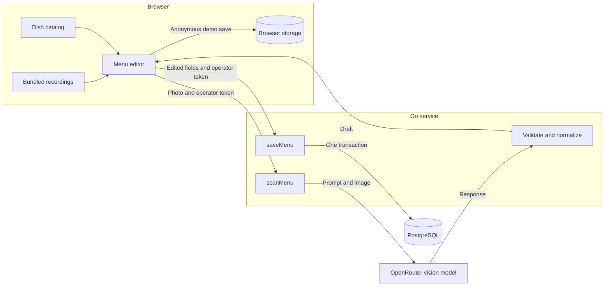

# Menu Import

The Citrus Window menu lists *Charred corn* at $6.50 and gives no dietary label. In the recorded Gemini 2.5 Flash-Lite run, the name and price matched the menu, but the model also marked the dish vegetarian and reported 99% confidence for the item. DeepSeek returned the same name and price and left the dietary field empty. A restaurant owner looking at those drafts needs the original photo to decide what to keep. [Source menu](client/assets/citrus-window.png) · [Recorded responses](client/src/demo-runs.json)

That example explains the split between the two API operations. `scanMenu` reads a photo and returns a draft. Only `saveMenu` writes dishes, after the owner has had a chance to correct them. Go can check that a price is valid and a dietary flag is a boolean. It cannot tell whether the menu actually printed that flag.

This sample reimplements one workflow from my Laravel Billing project using Go, GraphQL, PostgreSQL and an Expo/React client. It saves to its own database. [Try the demo](https://menu-review.smartmade.site/) · [Run locally](README.md#run-the-complete-application)

## Where each operation runs

Go serves the Expo web export and the GraphQL API from one container. Every GraphQL request requires an operator token in `X-Review-Token`. The OpenRouter key stays on the server. Recorded playback reads bundled data in the browser, so a reviewer can try all nine image/model combinations without either credential. [Server configuration](server/cmd/server/main.go) · [API contract](server/internal/api/schema.graphql)

## Follow one dish through the system

1. **Read the photo.** For a live import, the client sends one JPEG or PNG as a data URI. Go checks the declared format against the bytes, the decoded size (4 MiB maximum) and the dimensions (25 megapixels maximum). The provider receives the image and extraction prompt. Go requires a completed response and checks its JSON structure. A truncated response fails the scan. An unreadable price in an otherwise valid dish can remain empty for review. [Scanner](server/internal/menu/scanner.go) · [Normalizer](server/internal/menu/normalize.go)
2. **Represent the price.** For Charred corn, the decimal text `6.50` becomes integer `priceMinor: 650`. The editor displays `6.50` and parses edits back into minor units. Parsing decimal digits directly avoids floating-point rounding. An ambiguous currency stays `UNKNOWN` until the owner selects USD or INR. Selecting a currency never converts the amount. [Go parser](server/internal/menu/normalize.go) · [Client parser](client/src/menu.ts)
3. **Resolve what the model cannot.** The owner can change the dietary flag to *Unspecified*, edit prices and portions, attach a dish photo, or add a missed dish. A confidence percentage refers to the original transcription. “Mark as verified” is an optional visual aid that resets on edit. Neither field is part of the save contract. [Dish editor](client/src/DishEditor.tsx) · [Save input](server/internal/api/schema.graphql)
4. **Enrich the listing.** The ten-entry catalog supplies illustrations for matching names. A typo such as *Gingr soda* can produce a suggestion for *Ginger soda*. Accepting it changes the name and category only. A tie produces no suggestion. Unknown dishes remain editable, and an uploaded photo takes precedence over catalog artwork. [Matcher](client/src/matching.ts) · [Matching tests](client/tests/catalog.test.ts)

## What Save guarantees

With no token, saving a recorded demo on the web writes to that browser’s local storage. Clearing site data removes those menus. A storage error leaves the draft open. With an operator token, the same editor sends the edited menu to the server, whether the draft came from a recording or a live scan. [Save routing](client/App.tsx) · [Browser storage](client/src/demoStorage.ts)

For a server save, Go validates the submitted fields again. It requires a menu name, a supported currency, 1–100 dishes, and a positive base price and valid portion prices for each dish. Dietary status can remain unknown. PostgreSQL inserts the menu and its ordered dishes in one transaction. Portions are stored as JSONB because the application reads and saves them with their dish. The source menu image, confidence values and verification markers are absent from the saved record. [Validation](server/internal/menu/model.go) · [Database schema](server/internal/store/schema.sql)

Two failures have different consequences for the owner:

| What happened | What the owner can rely on | Evidence |
|---|---|---|
| Two dishes have the same category and name in one save. | PostgreSQL rejects the second insert and rolls back the parent and earlier dish. The owner can correct the draft. | [Transaction](server/internal/store/postgres.go) · [Rollback test](server/internal/store/postgres_test.go) |
| The client times out waiting for a save response. | The transaction may already have committed. Reload saved menus before retrying. Each successful request creates a new menu, so repeating it can create a duplicate. | [Client timeout handling](client/src/api.ts) · [Save resolver](server/internal/api/graphql.go) |

## Connecting another client

A client can use the [GraphQL schema](server/internal/api/schema.graphql) independently of the Expo screens. Send `scanMenu(image: ...)` to `POST /graphql`, present the draft alongside its source, and preserve nullable fields while editing. On explicit save, send `saveMenu(input: ...)`. Use `menus` to read the latest 20 saved menus. An application that already has a trusted, edited draft can call the save operation directly.

To connect Billing, an engineer would need to map dishes and portions to Billing’s existing records and authorize writes for the correct restaurant. The current repository interface exposes `Save` and `List` without a tenant identifier. Adding restaurant identity therefore requires changes at the authorization and storage boundaries together. [Repository interface](server/internal/api/graphql.go) · [Existing store](server/internal/store/postgres.go)

## Evidence and operating limits

- **Model quality.** Each of three models matched all 34 reference name/price pairs across three synthetic menus. Those counts exclude dietary flags and omitted content on other menus. Each recording includes the source image hash, model identity, raw response, normalized draft and usage. The original prompt was not archived with each run, and the current prompt has changed. [Inputs and results](README.md#recorded-model-results)
- **Provider failure.** The live scanner can retry a transport error, HTTP 429 or server error once. Each provider call has a 12-second timeout within a 45-second GraphQL deadline. Retrying may incur another provider charge. An unconfigured server can still serve the recorded demo.
- **Sample scope.** Live import accepts a single photo. PDF and multi-page import are outside this sample. One operator credential protects the API. Shared restaurant use would require tenant isolation, rate limits and migrations. Dish photos can individually meet their size limit yet exceed the combined 6 MiB request limit. Saved menus have no edit or delete operation. Native-device and GCP execution remain unverified. [Scope and limits](README.md#limitations)
- **Verification.** CI runs Go race tests against PostgreSQL, client tests, type checking, a web build and a database health check. For storage changes, run the Compose test profile so the rollback test uses a real database. For changes to price handling, check both parsers. For prompt changes, compare new recordings with the reference transcription and retain the raw output. [Test commands](README.md#run-tests) · [Verification record](docs/VERIFICATION.md)

## Replaying a scan and checking a deployment

The recorder requests temperature zero, a 2,500-token output limit and disabled reasoning. The live scanner also requests temperature zero but leaves the output limit and reasoning settings to the provider. These are request settings, not measurements of the model’s internal effort. To investigate a discrepancy, start with the stored image hash, returned model ID and raw response. If the raw response contains the error, changing the parser will not fix that recording. If only the draft is wrong, inspect normalization. [Recorder](server/cmd/record-demos/main.go) · [Live scanner](server/internal/menu/scanner.go) · [Recorded data](client/src/demo-runs.json)

`GET /healthz` gives PostgreSQL two seconds to answer a ping. A database failure returns HTTP 503. A healthy response establishes database connectivity only. If recorded playback succeeds but a live upload fails, check the operator token, the server’s OpenRouter configuration and the scan response. Recorded playback never calls the provider. [Health handler and provider setup](server/cmd/server/main.go)

## Developer handoff

| When changing | Start here | What to check |
|---|---|---|
| Provider or extraction prompt | [Scanner](server/internal/menu/scanner.go), [recorder](server/cmd/record-demos/main.go) | [Scanner tests](server/internal/menu/scanner_test.go) for retry, cancellation and invalid responses. Compare new output with the source image. |
| Price or dietary rules | [Normalizer](server/internal/menu/normalize.go), [save validation](server/internal/menu/model.go), [client fields](client/src/menu.ts) | Run [Go parsing tests](server/internal/menu/normalize_test.go) and [client tests](client/tests/menu.test.ts). Preserve the distinction between zero, missing and false. |
| GraphQL fields or authorization | [Schema](server/internal/api/schema.graphql), [handler](server/internal/api/graphql.go), [client requests](client/src/api.ts) | Follow the fields through [App](client/App.tsx) and run [API tests](server/internal/api/graphql_test.go). |
| SQL or menu persistence | [Schema](server/internal/store/schema.sql), [store](server/internal/store/postgres.go) | Run [round-trip and rollback tests](server/internal/store/postgres_test.go) with the Compose test profile. Without `TEST_DATABASE_URL`, the integration test skips. |
| Catalog or demo behavior | [Matcher](client/src/matching.ts), [catalog](client/public/kitchen/catalog.json), [demo storage](client/src/demoStorage.ts) | Check [ties and image hashes](client/tests/catalog.test.ts) and [browser saves](client/tests/demoStorage.test.ts). |
| Review screens | [Import](client/src/ImportScreen.tsx), [model selection](client/src/DemoSelector.tsx), [dish editor](client/src/DishEditor.tsx), [saved menus](client/src/SavedMenus.tsx) | Open a recording, edit a price, save and reopen it. Check both phone and desktop widths. |

The [CI workflow](.github/workflows/checks.yml) exercises the database, builds the client and checks service health. Interactive browser checks and paid provider evaluations are separate verification steps. Startup SQL runs under a PostgreSQL advisory lock to serialize concurrent application starts. A team adopting the sample should plan versioned migrations before making changes to an existing restaurant database. [Verification record](docs/VERIFICATION.md) · [Schema bootstrap](server/internal/store/postgres.go)

## Authorship

The workflow comes from my Billing project. I used extensive AI assistance to prepare this implementation, its tests and this document.
