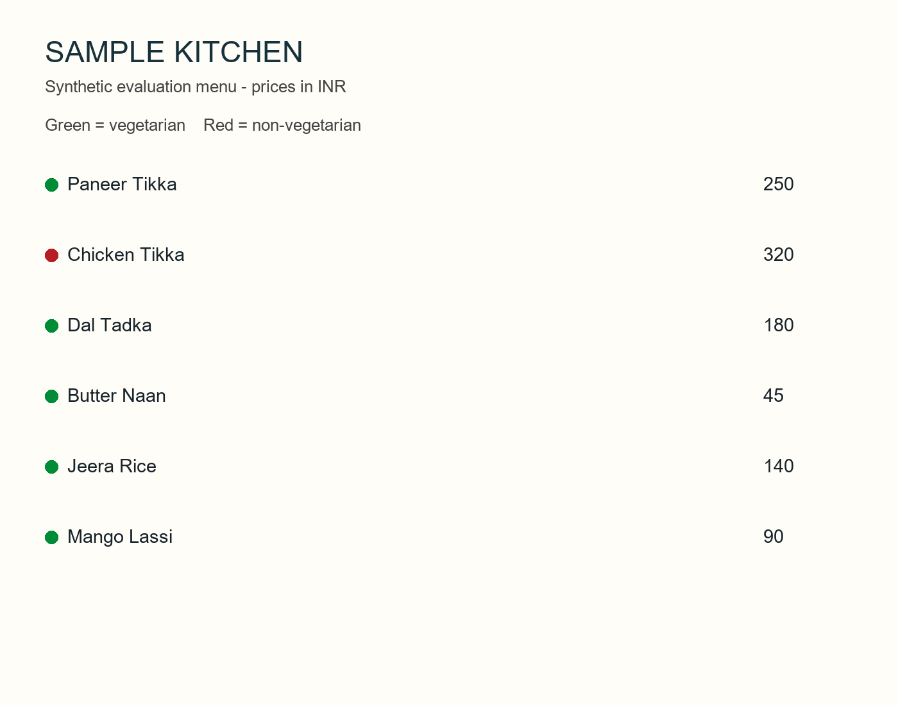
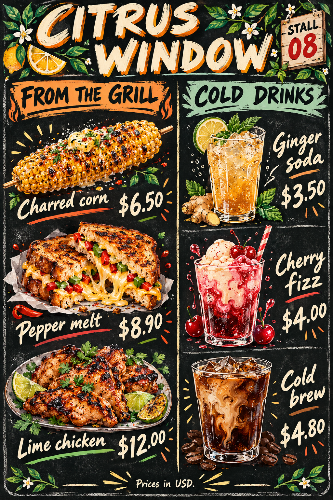
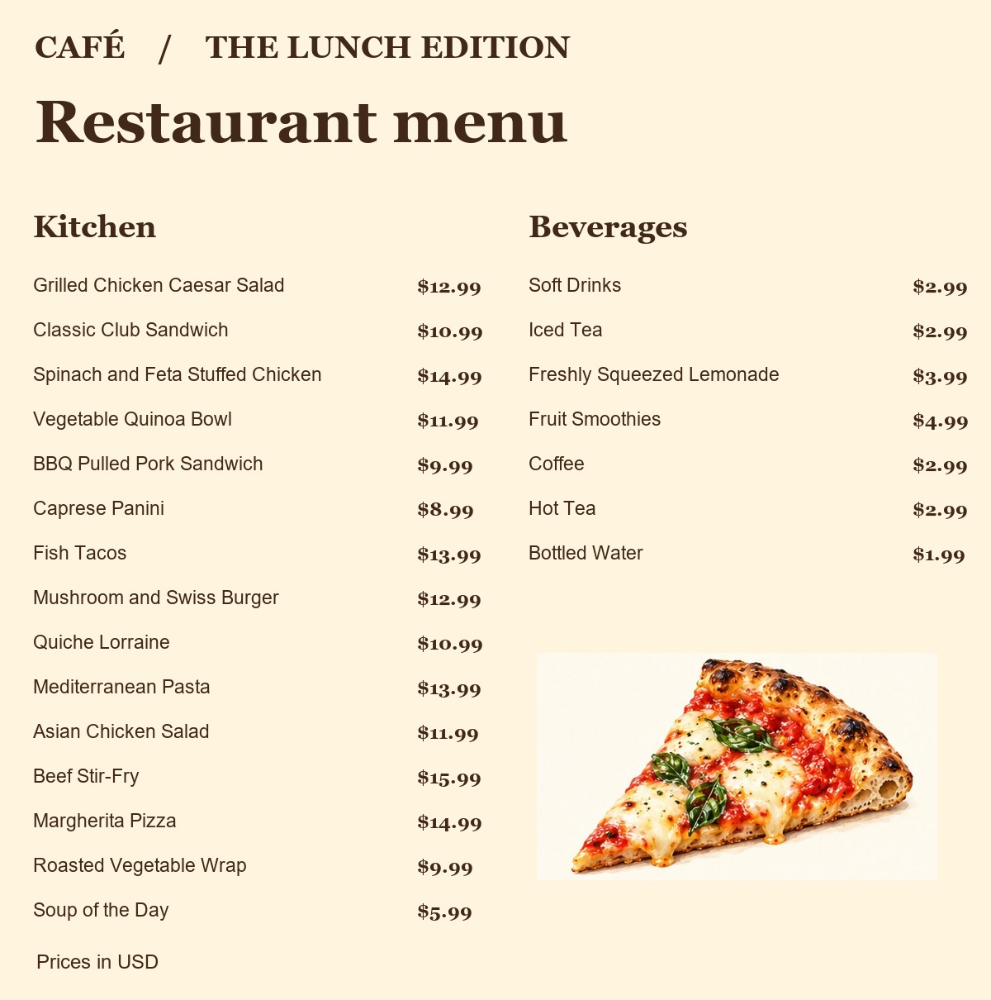

# Menu Import

A restaurant owner can turn a menu photo into an editable draft, check it against the original, and save the reviewed dishes together. This is a focused, AI-assisted reimplementation of a menu-import workflow from my Billing project.

**[Open the hosted demo](https://menu-review.smartmade.site/)** → **Open menu demos**. Choose a photo and a model to inspect its recorded output. Recorded menus can be edited and saved in the same browser without a token. Those demo saves stay on that browser and device. Live scanning and restaurant database saves require a configured server and operator token, as described below.

**Developer handoff** · [Architecture and source map](ARCHITECTURE.md) · [GraphQL contract](server/internal/api/schema.graphql) · [Run the tests](#run-tests)

## What you can try

| Entry point | What happens | What you need |
|---|---|---|
| Recorded demo | Choose one of three photos and a recorded model response. Compare the image, edit a dish, add a missing dish or attach a photo. Save the result in this browser. | A web browser |
| Live import | Upload one JPEG or PNG. The Go service requests a transcription through OpenRouter and returns an editable draft. | A configured server, provider key and operator token |
| Restaurant save | Save a valid draft to PostgreSQL. Reopen saved menus to read it back. A failed dish insert rolls back the complete save. | An operator token and a running database |

The ten-dish catalog supplies illustrations and suggests close spelling matches. Accepting a suggestion changes the name and category. The restaurant keeps control of prices, dietary labels and dishes outside the catalog. “Mark as verified” helps the operator track progress during review. It is optional and is not stored with the menu.

## Recorded model results

Three synthetic menu images were scanned once each with three models through OpenRouter. The table counts matching **dish-name and price pairs**, ignoring name case and surrounding whitespace. It does not score categories, dietary labels, confidence, latency or real-world accuracy.

Select an image to inspect the exact input at full resolution. Each cell counts matching name/price pairs against that image’s reference transcription.

| Recorded input | Classic Indian menu | Citrus Window | Café Lunch Edition |
|---|---|---|---|
| Source photo | <a href="client/assets/sample-clear.png"></a> | <a href="client/assets/citrus-window.png"></a> | <a href="client/assets/lunch-edition.jpg"></a> |
| Reference | [6 dishes, plain print](client/src/recorded.json) | [6 dishes, illustrations](client/src/citrus.json) | [22 dishes, two columns](client/src/lunch.json) |
| `qwen/qwen3.7-flash` | 6/6 | 6/6 | 22/22 |
| `google/gemini-2.5-flash-lite` | 6/6 | 6/6 | 22/22 |
| `deepseek/deepseek-v4.1-flash` | 6/6 | 6/6 | 22/22 |

**Dietary labels need particular care.** The illustrated and two-column menus contain no printed dietary labels, yet some models supplied them despite being instructed to leave them unspecified. A valid-looking AI result is not proof that the source supports it. The owner must check the original image.

The [recordings](client/src/demo-runs.json) contain the image hash, model, time, original response, normalized draft and reported usage. The nine calls cost $0.001571 in total according to OpenRouter. The request used temperature 0, a 2,500-token output limit and asked for reasoning to be disabled. The original prompt was not stored with each run and the current prompt has since changed; the [recorder](server/cmd/record-demos/main.go) runs the current prompt.

## Relationship to Billing

Billing already has owner-reviewed menu import, multi-photo handling, provider fallback and a transactional import into a restaurant's actual menu. This repository does not integrate with Billing or replace those features. It reimplements a narrower workflow using Go, GraphQL, PostgreSQL, TypeScript, React and Expo, and adds integer minor-unit prices, currency review, catalog suggestions and a public comparison of recorded model outputs. It currently handles one photo per scan. My longer-term goal is to let an owner record incoming stock and route table orders by voice. Inventory, voice input and kitchen routing are outside this sample.

## Run the complete application

Requires Docker with Compose. No host Go or Node installation is needed.

```sh
docker compose up --build -d app
```

Open http://localhost:8780. Enter the local-only operator token `local-review-only-change-me`, then choose **Open menu demos**. Edit a name or price and save. Select **View saved menus** to verify persistence.

## Configure live scanning

1. In the repository root, copy `.env.example` to `.env` (PowerShell: `Copy-Item .env.example .env`; macOS/Linux: `cp .env.example .env`). If you already have a .env file, edit it in place.
2. Set `OPENROUTER_API_KEY` in that file. The default model is `google/gemini-2.5-flash-lite`. To change it, set `OPENROUTER_MODEL` to an image-capable model.
3. Run `docker compose up -d --build app`. After changing only a key or model, run `docker compose up -d app` again so the container receives the new configuration.
4. Open http://localhost:8780, enter the operator token from your local configuration, and choose **Upload menu photo**. Use a PNG or JPEG to exercise live extraction. Each uploaded photo is sent to the configured provider.

The browser sends the image to the Go service. Only that service receives the configured provider keys and calls the provider. Git and the Docker build context exclude local environment files. For managed hosting, inject the same variables as runtime secrets. Avoid sharing rendered Compose configuration because it contains resolved credentials.

Stop containers with `docker compose stop`. The menu database is persisted in a named volume. The example credentials are for the loopback-only local demo, not a shared deployment.

## Run tests

Real PostgreSQL integration tests and Go race detection:

```sh
docker compose --profile test run --rm test
```

This starts a separate `menu_review_test` database, tests round-trip persistence, and forces a database constraint failure after a parent and first child insert to verify rollback. The test refuses database names that do not end in `_test`.

Client tests and type checking (Node 24):

```sh
cd client
npm ci
npm run lint
npm run typecheck
npm test
npx expo export --platform web
```

The Docker build runs the client checks too. Go unit tests can run without Postgres using `go test ./...`, but the integration test will explicitly skip unless `TEST_DATABASE_URL` is set. Do not mistake that for a complete verification run.

## Integrating the importer

A second client can use the same [GraphQL schema](server/internal/api/schema.graphql). POST to `/graphql` with the operator token in `X-Review-Token`. Keep the OpenRouter key on the Go server.

1. Call `scanMenu(image: ...)` with a JPEG or PNG data URI. Render the returned currency, dishes, prices and portions as an editable draft. Scanning does not write to the database.
2. Preserve missing values during editing. For example, `priceMinor: 1010` means 10.10 in the selected currency. A missing price needs correction. A missing dietary label can remain unspecified.
3. Pass the edited data to `saveMenu(input: ...)` after the operator chooses Save. Use `menus` to read back the latest 20 menus. A timeout after save can mean the write already committed. Check the list before retrying.

To connect a different storage system, start at the [repository interface](server/internal/api/graphql.go) and its [PostgreSQL implementation](server/internal/store/postgres.go). A Billing integration would also need restaurant identity and a mapping to its existing menu records. The sample currently writes to its own database. See the [architecture guide](ARCHITECTURE.md) for field ownership, validation, failure paths and tests to run when changing the contract.

## Stack coverage

- **Go + GraphQL + PostgreSQL:** implemented and tested together with a real database.
- **TypeScript + React + Expo:** one shared React Native component tree; the web export is built and browser-checked. Native Android/iOS execution is not claimed.
- **GCP:** the non-root container listens on `PORT` and includes a Cloud Build configuration and a Cloud Run/Cloud SQL deployment guide. No GCP deployment has been performed.

For native development, set `EXPO_PUBLIC_API_URL` to a backend reachable from the device before starting Expo; `localhost` on a phone refers to that phone. Use TLS and proper access controls for shared environments. This repository does not provision those environments.

## Limitations

- **One photo at a time.** Live scans accept a single JPEG or PNG. PDF and multi-page imports are not implemented in this sample.
- **AI output requires review.** A model can omit a dish, misread a valid-looking price, or infer a dietary label that is not printed. Confidence scores are model self-assessments, not measured probabilities. The recorded tests cover only three synthetic menus.
- **Single-operator access.** Live scanning and restaurant saves use one operator token. There is no restaurant login, multi-tenant isolation or rate limiting. Browser-saved recorded demos stay on that device and are subject to browser storage limits.
- **Retrying a save can create a duplicate.** A timeout can occur after the database commits. Check saved menus before retrying. The app does not yet offer an idempotency key.
- **Large photo collections can exceed the request limit.** Each dish photo is capped at 350,000 characters and the whole GraphQL request at 6 MiB, so a menu with many valid photos may still be too large to save in one request.
- **Menu management is limited.** Each server save creates a new menu. The list shows the latest 20; editing and deleting saved menus are not implemented. Duplicate names in the same case-sensitive category cause a transaction rollback.
- **Deployment and device coverage.** The sample bootstraps its schema at startup. A production service needs versioned migrations and appropriate database permissions. Native Android/iOS execution and GCP deployment have not been verified. A local live Go scan returned 22 items after an earlier attempt failed; this does not establish reliability.

The Expo build dependencies pin `minimatch` 11.0.1 and `glob` 14.0.2 via explicit overrides to address an npm audit advisory. Validate checks and web export when changing these overrides.

See [architecture and developer handoff](ARCHITECTURE.md), [design notes](docs/DESIGN.md), [verification](docs/VERIFICATION.md), and [GCP deployment](docs/GCP.md).

## AI assistance and source

Implementation, tests and documentation were prepared with extensive AI coding assistance. The workflow comes from an existing Laravel billing project; this is a separate reimplementation. Recorded model results and their provenance are in `client/src/demo-runs.json`. No production tenant data or real credentials are included. The Expo template retains its bundled MIT license notice. Original contributions are published for interview review with permission, without a separate general open-source license grant.
