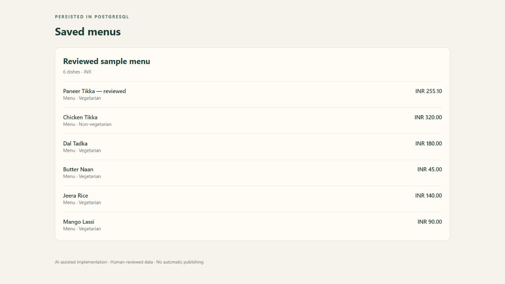
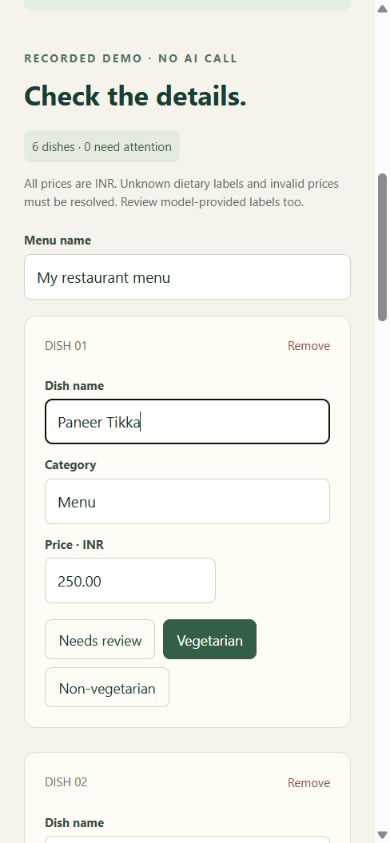

# Verification record

## Current web sample

At [release eed17f7](https://github.com/AI-07223/menu-import-go-expo/commit/eed17f7), the hosted recorded-demo flow was exercised at 1440, 900, 390 and 320 pixels. Checks covered column count, horizontal overflow, editing a dish and saving in browser storage. The [CI run](https://github.com/AI-07223/menu-import-go-expo/actions/runs/41686300646) separately built the app and ran the automated suite. These browser checks did not exercise a new paid scan or a native device.

The [current recordings and source images](../README.md#recorded-model-results) supersede the earlier experiment below.

## Historical checks

The following notes and screenshots describe the earlier revision verified locally on 1–2 November 2026. No application submission or cloud deployment was performed.

## Automated checks

- **11 Go tests passed with the race detector**, using the Go 1.27.3 container. This includes authenticated GraphQL, unresolved dietary validation, exact price parsing, malformed-response fallback, transient retries, cancellation, provider failure, and real PostgreSQL round-trip/rollback.
- **PostgreSQL 17.11**, using a separate `menu_review_test` database. The rollback test intentionally fails the second child insert and confirms no new parent or partial child rows remain.
- **Three TypeScript model tests passed**, including fractional prices, unknown/false preservation, and invalid portion blocking.
- TypeScript `tsc --noEmit` and Expo ESLint (zero warnings) passed.
- Final multi-stage Docker build passed, including Expo web export and all client checks after dependency overrides. The final runtime is non-root (UID 65532).
- `npm audit` reported zero known vulnerabilities after explicit minimatch/glob overrides. This is a point-in-time dependency check, not a complete security audit.
- Build/runtime/database base images are pinned to the exact digests used locally.

## Browser checks on the compiled web application

1. Loaded the explicitly labelled recorded demo through the Go GraphQL endpoint.
2. Changed a dietary label to “Needs review”; save was blocked.
3. Entered a negative price `-50`; save remained blocked.
4. Changed the first dish to `Paneer Tikka — reviewed`, entered `255.10`, and saved six dishes to PostgreSQL.
5. Reloaded the browser (clearing the in-memory token and draft), entered the token again, and fetched saved menus. The edited name and **INR 255.10** persisted.
6. Checked the review at a 390×844 viewport. Document width was 390 with no elements wider than the viewport.

## Explicitly not established

- Native Android/iOS runtime behavior: Expo web was tested; phone-sized web is not a native-device test.
- GCP deployment: container and configuration exist, but no Cloud Run or Cloud SQL resource was created.
- Live Go-provider accuracy: provider paths were exercised with local HTTP test servers. The recorded six-dish demo comes from a prior PHP/Mistral experiment. Those older measurements are not new Go results.
- Production multi-tenancy, rate limits, concurrent save idempotency, operational resilience or broad real-menu accuracy.

The independent GitHub workflow runs the Go/PostgreSQL suite, production image build and HTTP health check. Consult its actual run result before claiming CI success.
